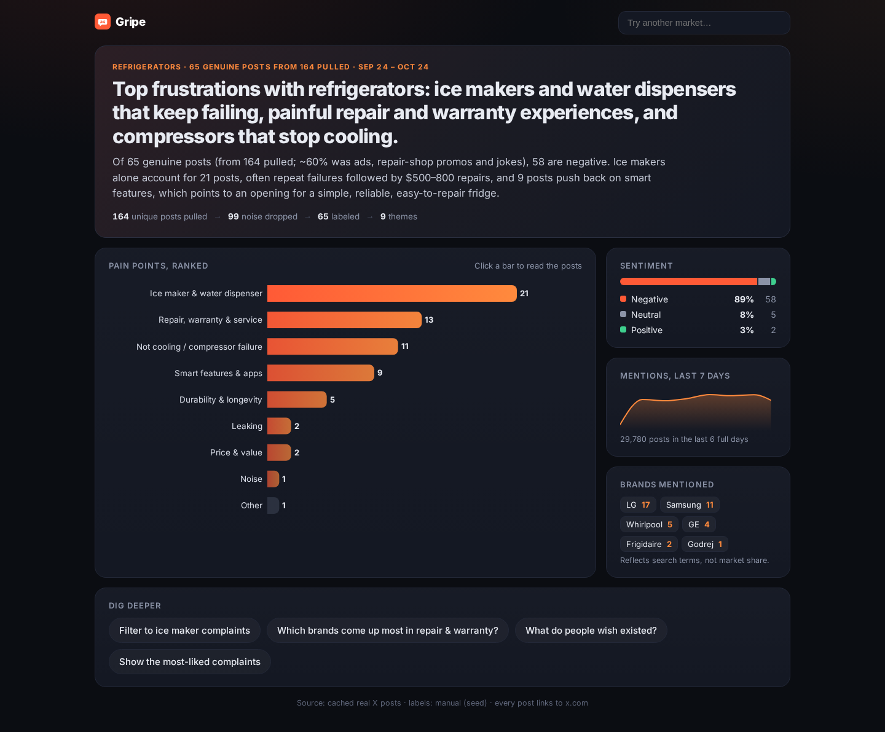

# Gripe

**Find the pain points in any market, straight from X.** Type a market ("refrigerators") and Gripe pulls real X posts, filters out the noise, labels each post with Grok, groups them into pain-point themes, and shows a dashboard where every claim links back to the actual posts.

Built for xAI Hackathon **Track 4: Best Use of xAI's GrokBots**.



## How it works

```
pull posts ─► dedupe ─► filter noise ─► label each post ─► group into themes ─► summary + dig-deeper ideas
 (Grok x_search    heuristics +       Grok: sentiment,     Grok clusters        Grok writes the
  or X API v2)     Grok relevance     pain point, brand,   pain-point phrases   headline and chips
                   check              gist, wish, rep.     into 6-10 themes
```

* **Pull:** several brand-neutral, complaint-oriented query variants (`broken`, `hate`, `wish`, `problem`, `returned`, `worst`, `stopped working`, `regret`, …, all with `-is:retweet lang:en`).
  * `xai_x_search` (default) uses the xAI **Responses API** with Grok's built-in **`x_search`** tool. Grok returns posts as JSON, and **any post whose status id is not in the response's tool citations is dropped**, so hallucinated posts can't get in.
  * `x_api_v2` uses the official X API v2 recent search, plus `counts/recent` for a 7-day volume trend.
* **Filter noise:** in our prototype about 60% of raw results were ads, deal bots, repair-shop promos, content-farm accounts, and jokes. Heuristics drop `#ad`/deal posts, affiliate links, phone numbers, repeat-posting accounts, duplicates, and off-topic posts. Then a Grok relevance check removes jokes, news, and marketing.
* **Label:** batched Grok calls give each post a sentiment, a pain-point phrase, a brand, a one-line gist, a representativeness score (0–1), and an optional "wish" (unmet need).
* **Group:** Grok clusters the pain-point phrases into 6–10 categories plus `other`.
* **Summarize:** Grok writes a 2–3 sentence headline and 3–4 "dig deeper" chips.
* **Cache:** results are saved per normalized topic in `backend/data/cache/<slug>.json`. Cached topics load instantly with zero API calls, and their dig-deeper chips work offline.

## Quick start (fresh clone)

Requirements: Python 3.10+, Node 18+ (tested on Node 20.11+). Works in macOS/Linux terminals and Windows Git Bash.

```bash
git clone https://github.com/Tomn223/gripe && cd gripe
cp .env.example backend/.env      # optional; add XAI_API_KEY for live topics
./dev.sh                          # first run creates backend/.venv + installs npm deps
# open http://localhost:5173
```

`./dev.sh --bg` runs both servers in the background (logs go to `logs/`), and `./dev.sh --stop` stops them. The ports default to backend `8000` and frontend `5173`; override them with `BACKEND_PORT` and `FRONTEND_PORT`.

The three example chips (refrigerators, standing desks, e-bikes) are served from the committed cache, so the demo works with **no keys and no network calls to xAI/X**.

Manual setup, if you'd rather skip the script:

```bash
python3 -m venv backend/.venv && backend/.venv/bin/pip install -r backend/requirements.txt
(cd backend && .venv/bin/uvicorn app.main:app --port 8000)
(cd frontend && npm install && npm run dev)        # proxies /api -> :8000
```

Tests (no network; the live path is tested against a mocked xAI API):

```bash
cd backend && .venv/bin/python -m pytest -q
```

## Environment variables

Keys live **only in the backend** (env vars or `backend/.env`, which is gitignored). The frontend calls `/api/*` and never sees a key.

| Var | Needed for | Where to get it |
| --- | --- | --- |
| `XAI_API_KEY` | Live topics (Grok labeling, plus X search in `xai_x_search` mode) | [console.x.ai](https://console.x.ai) → API Keys |
| `X_BEARER_TOKEN` | Only for `DATA_SOURCE=x_api_v2` (also enables the 7-day volume chart for live topics) | [developer.x.com](https://developer.x.com) → Projects & Apps → Keys and tokens → Bearer Token |
| `DATA_SOURCE` | `auto` (default), `xai_x_search`, or `x_api_v2` | `auto` picks `xai_x_search` when `XAI_API_KEY` is set |
| `GROK_SEARCH_MODEL` | Model that runs `x_search` | default `grok-4.7` |
| `GROK_LABEL_MODEL` | Model for relevance, labeling, grouping, and summary | default `grok-4.20-0309-non-reasoning` |
| `XAI_BASE_URL` | OpenAI-compatible endpoint | default `https://api.x.ai/v1` |
| `XAI_SEARCH_CALLS` | Parallel x_search calls per topic (cost knob) | default `3` |
| `LOOKBACK_DAYS`, `MAX_POSTS`, `LABEL_BATCH` | Pipeline knobs | `30`, `200`, `20` |

To run a live end-to-end check from the CLI: `backend/.venv/bin/python scripts/live_smoke.py "air fryers"`.

## API

| Endpoint | What it does |
| --- | --- |
| `GET /analyze?topic=…[&refresh=true]` | Returns `{status:"done", cached:true, result}` for cached topics. Otherwise it starts a live job and returns `{status:"running", job_id, stages}`. |
| `GET /jobs/{job_id}` | Progress for the loading screen: `stages[]` (`pull`, `filter`, `label`, `group`, `summary`), each with status, count, and detail; also `result` when done, or `error`. |
| `GET /posts?topic=…&category=…&limit=50` | Posts in a category, sorted by representativeness (most representative first). |
| `POST /dig` `{topic, suggestion}` | Re-filters the labeled data (`kind`: `filter_category`, `brands`, `wishes`, `top_liked`, or `query`). Free-text questions that match fewer than 5 posts trigger a narrower live re-query when keys exist. |
| `GET /health`, `GET /topics` | Live-mode status and the list of cached topics. |

## Cache schema (`backend/data/cache/<slug>.json`)

`<slug>` is the normalized topic (lowercased, with aliases resolved, so `fridge` maps to `refrigerators`).

```jsonc
{
  "schema_version": 1,
  "topic": "refrigerators",
  "generated_at": "2026-10-24T19:30:00+00:00",
  "source": "live:xai_x_search | live:x_api_v2 | seed:x-api-search+manual-labels",
  "model": {"search": "grok-4.7", "label": "grok-4.20-0309-non-reasoning"},
  "queries": ["(\"refrigerators\" OR \"refrigerator\") (broken OR worst OR …) -is:retweet lang:en", "…"],
  "stats": {"raw": 164, "deduped": 164, "noise_dropped": 99, "kept": 65,
            "noise_reasons": {"ad / deal post": 12, "llm: joke": 9}, "search_calls": 3,
            "unverified_dropped": 0, "elapsed_s": 61.2, "llm_usage": {"calls": 9, "prompt_tokens": 0, "completion_tokens": 0}},
  "summary": {"headline": "Top frustrations with …", "text": "2-3 sentences"},
  "categories": [{"name": "Ice maker & water dispenser", "count": 21, "share": 0.323, "description": "…",
                  "sentiment": {"negative": 17, "neutral": 3, "positive": 1},
                  "top_brands": [{"name": "Samsung", "count": 5}], "example_gists": ["…"]}],
  "sentiment": {"negative": 58, "neutral": 5, "positive": 2},
  "brands": [{"name": "LG", "count": 17}],
  "volume": {"query": "…", "granularity": "day", "series": [{"date": "2026-10-18", "count": 4645}]},  // or null
  "dig_suggestions": [{"label": "Filter to ice maker complaints", "kind": "filter_category", "category": "Ice maker & water dispenser"}],
  "notes": ["…"],
  "posts": [{"id": "2105416658852397100", "url": "https://x.com/<user>/status/<id>", "username": "…",
             "created_at": "2026-10-01T…Z", "text": "verbatim post text", "likes": 413, "reposts": 12,
             "sentiment": "negative", "category": "Durability & longevity", "brand": "Frigidaire",
             "gist": "one line", "representativeness": 0.87, "wish": "unmet need or ''",
             "pain_point": "live runs only", "verified_by_citation": true}]
}
```

`representativeness = 0.65 × labeler score + 0.25 × log-normalized likes + 0.10 × (negative ? 1 : 0)`.

## Project layout

```
backend/app/      FastAPI app: main.py (endpoints), pipeline.py, sources.py (x_search / X API v2),
                  llm.py (Grok client), noise.py, analysis.py, dig.py, livedig.py, jobs.py, cache.py
backend/data/cache/  committed demo caches
backend/tests/    pytest (mocked xAI + API tests)
frontend/src/     React + Vite + Recharts UI
seed/             real labeled posts for the demo topics
scripts/          build_seed.py, live_smoke.py, screenshots.py
screenshots/      headless captures of every screen
```

## Opportunities (heuristic score)

Each theme with 3+ posts gets `score = 10 x (0.40 x frequency + 0.35 x intensity + 0.25 x fixability)`:

* **Frequency**: share of genuine posts in the theme, scaled so the biggest theme = 1.0.
* **Intensity** (deterministic, `backend/app/opportunities.py`): 70% text signals (share of posts with repeat-failure, `$` amount, or switching / "never again" / return language, plus a bonus per signal type found in 20%+ of posts) and 30% likes + reposts. The UI shows which signals fired.
* **Fixability**: Grok judges product/design (1.0), mixed (0.6), or structural (0.2), with a one-line reason, plus 1–2 sentences of "why this is an opening" and 2 evidence posts. Live runs make this **one extra `GROK_LABEL_MODEL` call** for all themes (validated JSON; falls back to unjudged scores). For the three seed topics these fields were hand-written from the cached posts (`scripts/seed_opportunities.py`).

"Open in Grok" opens `https://grok.com/?q=<prompt>` in a new tab with the top 3 opportunities and also copies the prompt to the clipboard.
